**I build backends that keep their promises when machines die mid-write.**

Software Development Engineer, R&D at Ninestars, Bangalore. Python at work, Go on the side: queues, Postgres, and what happens when a worker dies halfway through a job.

[Website](https://heyaryan.xyz/?utm_source=github&utm_medium=profile_readme&utm_content=header) · [Resume](https://drive.google.com/file/d/1x5JK6bJyfGeRZKN_i39LPHtioS43m_os/view) · [LinkedIn](https://linkedin.com/in/aryananand18) · [Contact](https://heyaryan.xyz/contact?utm_source=github&utm_medium=profile_readme&utm_content=header) · [Email](mailto:aryananand.syn@gmail.com)

## Projects you can poke at

### [odin](https://odin.heyaryan.xyz) · a durable workflow engine

Kill any process at any line: no run is lost and no step's side effect happens twice. Workflows are plain async Python functions whose event-sourced history in PostgreSQL is replayed, across 64 shards on fenced leases over 3 nodes, with a transactional outbox to RabbitMQ.

A 1-hour chaos soak closed **3,626 runs with zero double charges**. It still runs live on three nodes, and every ten minutes a scheduled scenario kills a node, cuts a link or breaks a dependency: [see the chaos log](https://odin.heyaryan.xyz/chaos).

`Python` `asyncio` `gRPC` `PostgreSQL` `RabbitMQ` `OpenTelemetry`

### [hermod](https://hermod.heyaryan.xyz) · ride dispatch in Go, on Manhattan's streets

Finds a rider's 20 nearest drivers by road in **0.79 ms** on a 36,108-node OpenStreetMap graph. Replaying 76,312 real NYC taxi requests in a simulator, matching in 10-second batches served **49% more riders** than greedy with 2,000 drivers. [Play the replay](https://hermod.heyaryan.xyz/replay).

`Go` `Dijkstra` `A*` `Hungarian matching` `Valkey` `OSRM`

### [nukeit](https://nukeit.heyaryan.xyz) · a one-tap failsafe for Android

Runs saved scripts and keyboard shortcuts on your own Linux, macOS and Windows machines over SSH, in one tap from the app or a home-screen widget, where dangerous ones need a second tap. No backend, no account.

`TypeScript` `React Native` `Expo` `Kotlin` `SSH`

### [LSD](https://marketplace.visualstudio.com/items?itemName=aryan0000.psychedelic-lsd-theme) · a high-contrast theme for VS Code

## At work

**Ninestars Information Technologies, R&D** · June 2025 – present

- Architected the backend of **AOTM FDI**, a credential-fraud detection platform live with a global credential-evaluation organisation, which has processed 50K+ documents.
- Built the rate-limiting and usage-billing layer that meters AOTM OCR in production, with admission in under 5 ms on a cache hit.
- Architected **AOTM Vault**, a secrets-management platform in production with 2 customers.
- Built the ML pipeline and telemetry layer of **AOTM PCI**, a sensor platform for museums, where SQL over raw telemetry caught 3 of 16 sensors failing while the config reported 97% fleet health.
- Built hybrid semantic search used by FDI and Vault, and a migration agent that moved a customer's 100+ GB from on-prem servers straight to S3.

Before that: ML intern at TIH IoT & IoE, IIT Bombay (2023), and a B.Tech in Computer Science and Engineering from VIT (2021–2025).

## Tools I reach for

`Python` `Go` `TypeScript` `SQL` · `Django` `FastAPI` `asyncio` `gRPC` · `PostgreSQL` `TimescaleDB` `Redis/Valkey` `RabbitMQ` `Celery` `Qdrant` · `Docker` `Jenkins` `GitHub Actions` `Prometheus` `Grafana` `OpenTelemetry` · `Next.js` `React` `Tailwind` · `PyTorch` `TensorFlow`

---

Hiring for backend or distributed systems, or curious how any of this works? [Get in touch](https://heyaryan.xyz/contact?utm_source=github&utm_medium=profile_readme&utm_content=footer).
